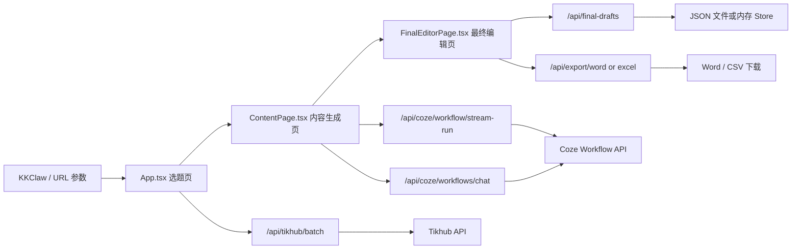

# Architecture

## High-Level Architecture

## Runtime Modes

### 1. Local Development / Traditional Server Mode

- 前端由 Vite 提供开发服务器
- `vite.config.ts` 将 `/api` 代理到 `http://localhost:8787`
- `server/index.js` 作为统一代理层对接 Coze 与 Tikhub
- 最终文案持久化到 `server/data/final-drafts.json`

### 2. Serverless Mode

- 静态前端可独立部署
- `api/` 目录提供与本地代理等价的处理器
- `api/_lib/draftStore.ts` 使用进程内 `Map` 保存临时文案
- 更适合平台托管，但临时存储是易失性的

## Frontend Page Responsibilities

### `App.tsx`

- 读取 URL 中的任务参数与 token
- 从 `sessionStorage` 恢复任务和已选题
- 请求外部任务面板 `http://127.0.0.1:18891/api/tasks/today`
- 调用 `/api/tikhub/batch` 批量解析抖音链接
- 组装选中的 topics，并跳转到 `/content`

### `ContentPage.tsx`

- 从 `sessionStorage` 读取选中的 topics、任务信息与历史工作流结果
- 调用 Coze 流式工作流生成标题、hooks、scripts
- 通过可选开关执行翻译与平台转写
- 管理待导出草稿数量
- 支持批量导出全部待处理文案
- 组装最终编辑载荷并跳转到 `/final-editor`

### `FinalEditorPage.tsx`

- 从 `sessionStorage` 恢复最终编辑载荷
- 允许用户二次编辑五类内容块
- 保存临时最终文案
- 导出单份 Word 或 Excel
- 导出完成后清理当前临时草稿并返回内容页

## Key Data Flows

### Topic Discovery Flow

1. 用户在首页输入或携带抖音链接
2. 前端调用 `/api/tikhub/batch`
3. 代理层先解析 `sec_user_id`
4. 再拉取作者视频列表
5. 前端从响应中整理作者名、热视频与统计信息

### Content Generation Flow

1. `ContentPage.tsx` 从已选 topics 中抽取分享链接
2. 按每批最多 3 条链接调用 `/api/coze/workflow/stream-run`
3. 以前端 SSE 读取方式持续拼接 `Message` / `Done` 事件
4. 将最终文本解析为 `titles`、`hooks`、`scripts`
5. 持久化到 `sessionStorage`

### Translation / Rewrite Flow

- 翻译走 `workflow/stream-run`，输入是已选标题、留存文案和脚本
- 平台转写走 `workflows/chat`，输入是选中的脚本和目标平台
- 两条链路都以 SSE 流式更新预览，完成后再解析为结构化结果

### Export Flow

1. 最终编辑页或内容页发起导出
2. 后端将草稿内容拼成纯文本 Word 或 CSV
3. 前端通过 Blob 触发下载
4. 成功后清理已保存草稿，避免积压

## Integration Points

### Coze

- `POST /v1/workflow/stream_run`
- `POST /v1/workflows/chat`
- 使用 Bearer Token 鉴权
- 前端依赖流式事件格式解析结果

### Tikhub

- `get_sec_user_id`
- `fetch_user_post_videos`
- 目前以串行批处理方式请求

### External Task System

- 首页直接请求 `http://127.0.0.1:18891/api/tasks/today`
- 与仓库内 Node 代理未完全统一
- 这是当前架构里最明显的外部耦合点之一

## Architectural Risks

- `ContentPage.tsx` 体量较大，状态与流程逻辑高度集中，后续扩展成本会持续上升
- 前端直接依赖一个硬编码的本地任务系统地址，不利于部署环境切换
- 本地模式和 Serverless 模式的草稿存储实现不一致，行为上可能出现差异
- 当前导出的 Word 实质上是纯文本 `.doc`，兼容性取决于消费端软件
- 未见自动化测试与 CI，流式接口和第三方集成的回归风险较高
